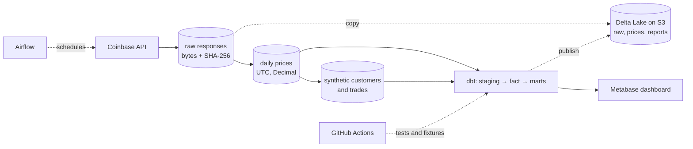

# Investment Data Pipeline & Analytics

A batch data pipeline for a simulated crypto brokerage: real market prices from an
API, through raw storage and dbt models, to a dashboard of trading volume and fee
revenue. The focus is on numbers that can be proven correct: dbt models and dashboard
cards are reconciled against independent SQL and fixture totals, and reruns are
checked to change nothing.

> **Data honesty:** BTC/ETH/SOL daily prices are real (Coinbase Exchange). The 1,000
> customers and 50,000 trades are **synthetic**, generated with a fixed seed so
> aggregations can be checked against known answers.



| Layer | Tools |
| --- | --- |
| Ingestion | Python, `requests`, bounded retries, raw-response capture |
| Storage | PostgreSQL 16, RustFS (S3 API), Delta Lake via `deltalake` |
| Transformation | dbt Core: 8 models, 88 data tests |
| Orchestration | Airflow 3 (daily ingestion, backfill, reprocessing) |
| Serving | Metabase with a read-only database role |
| Quality and CI | pytest, fixture reconciliation, GitHub Actions, Docker Compose |

**Highlights (each recorded in [verification](docs/verification.md)):**

- **Replayable ingestion:** every HTTP attempt is recorded, failed ones included; response
  bytes and their SHA-256 are kept before parsing. Idempotency was verified by loading the same
  captured response twice and comparing keys and values.
- **Proven metrics:** a small fixture with hand-computed totals runs through the same
  dbt models at four cutoffs. CI rebuilds it on a fresh database for pushes to
  `main` and pull requests ([hosted run](https://github.com/sanh0804/investment-data-pipeline/actions/runs/42075415267)).
- **Operable pipeline:** Airflow backfill and reprocessing with explicit UTC
  intervals; retries verified by injecting faults.
- **Auditable reports:** raw responses, rebuilt prices and each published report are
  versioned in Delta Lake on S3-compatible storage. A past report can be read back
  exactly, and a correction is explained row by row by a diff.

**Not proven by this project:** real customers or users, production load, cloud
deployment, alerting, and backup/restore. Balances, holdings and P&L are not modeled.

**Contents:** [Results](#verified-results) · [Dashboard](#dashboard-preview) ·
[Design choices](#design-choices) · [Quick start](#quick-start) ·
[Repository](#repository-guide) · [Limitations](#limitations) ·
[Runbook](docs/runbook.md)

## Verified results

Each row was executed and recorded with commands and outputs in
[verification](docs/verification.md) (Vietnamese).

| Check | Result |
| --- | --- |
| Idempotent ingestion | The same captured Coinbase response loaded twice: 1 row after each load, business values equal, no new API call |
| dbt models | 8 models and 88 data tests pass on 50,000 trades and 1,000 customers |
| Fixture reconciliation | The same models on a fresh test database match hand-computed totals (USD 475.94 volume, 0.48 fees) at four cutoffs |
| Dashboard | Metabase card results equal independent SQL (50,000 trades, USD 615,063,969.51 volume, 900 active customers) |
| Airflow | Scheduled, manual, three-day backfill and reprocessing runs succeeded; an injected failure blocked downstream tasks with no partial writes, and HTTP 503s recovered on task retry |
| Data lake: raw | 41 raw attempts → 25 content-addressed objects; a rerun changed nothing; an injected object corruption was detected |
| Data lake: rebuild | All 555 daily price rows rebuilt from raw objects equal the warehouse table |
| Data lake: audit | After a simulated trade correction, the diff listed exactly one day and one customer (USD 155.00 → 175.00); all five published reports read back exactly |
| Tests and CI | 70 Python tests pass locally and in the Linux CI container; the last GitHub-hosted run passed 62 on Python 3.12 and 3.13 |

## Dashboard preview

Screenshots from local Metabase using `portfolio-v1`, with an **October 27, 2026 UTC**
cutoff. Customers and executions are synthetic; reference prices come from Coinbase.

**Trading overview:** volume, fees, trade count, distinct active customers, and daily trends.


**Breakdowns:** volume by asset and BUY/SELL, customer segments, and customers ranked
by fees. Customer cards remain fixed snapshots when trading filters change.


## Design choices

| Choice | Reason and trade-off |
| --- | --- |
| Store raw responses before normalization | Supports inspection and replay; raw rows grow with repeated requests. |
| Upsert prices by source/product/UTC day | Reruns keep the grain and accept provider corrections; the table holds only the latest value. |
| Fix the synthetic seed, dates and price-input hash | Runs are comparable; a changed input is rejected instead of regenerating silently. |
| Run a small fixture through the same dbt models | Hand-computed totals expose join, cutoff and rounding errors that large totals hide. |
| Separate read-only role for Metabase | Dashboards cannot modify analytics; Metabase metadata lives in its own database. |
| Copy raw data and published reports to Delta Lake | Past reports can be reproduced and corrections explained; metrics stay defined only in dbt, so the lake never recomputes them. |
| RustFS instead of MinIO | The MinIO repository is archived and its image removed; the code uses only the S3 API. |
| Check exact Arrow schemas before Delta writes | In testing, Delta silently rounded a float written into a DECIMAL column. |

Deeper reasoning: [design decisions](docs/decisions.md) and
[model contracts](docs/models.md) (both Vietnamese).

## Quick start

Tested on macOS arm64 with Python 3.13 and Docker (Linux aarch64). Full steps,
ports and troubleshooting are in the [runbook](docs/runbook.md#local-setup).

```bash
python3 -m venv .venv && .venv/bin/python -m pip install -r requirements-dev.txt
python3 -m venv .venv-dbt && .venv-dbt/bin/python -m pip install -r requirements-dbt.txt
cp -n .env.example .env && chmod 600 .env        # then set POSTGRES_PASSWORD
.venv/bin/python scripts/init_metabase_env.py && .venv/bin/python scripts/init_lake_env.py

docker compose up -d --wait postgres
.venv/bin/python -m pipeline.init_db
.venv/bin/python -m pipeline.collector           # live Coinbase prices
.venv/bin/python -m pipeline.synthetic --dataset-id portfolio-v1 --seed 20261101 \
    --start 2026-05-01 --end 2026-10-28
.venv/bin/python scripts/run_dbt.py build \
    --vars '{"dataset_id":"portfolio-v1","as_of_date":"2026-10-27"}'

.venv/bin/python -m pytest -q                    # offline tests
.venv/bin/python scripts/verify_dbt.py           # fixture reconciliation on a test database
```

Then, as needed: [Metabase dashboard](docs/runbook.md#metabase-setup) ·
[Airflow](docs/runbook.md#airflow-daily-market-price-ingestion) ·
[Delta Lake layer](docs/runbook.md#delta-lake-layer) ·
[CI reproduction](docs/runbook.md#continuous-integration).

## Repository guide

| Path | Purpose |
| --- | --- |
| `pipeline/collector.py`, `normalize.py`, `db.py` | HTTP retries, raw capture, UTC/Decimal validation, upserts |
| `pipeline/synthetic.py` | Seeded synthetic customers and trades |
| `pipeline/lake*.py` | Delta Lake layer: raw objects, rebuilt prices, report publications |
| `analytics/` | dbt models, data tests and macros |
| `orchestration/` | Airflow DAG and images |
| `metabase/cards/` | Dashboard SQL |
| `scripts/verify_*.py`, `sql/verify*.sql` | Reconciliation and verification scripts |
| `tests/` | Unit tests and the reconciliation fixture |
| `.github/workflows/ci.yml` | CI: tests, fresh migrations with dbt fixture, DAG checks |
| `docs/` | Runbook, design decisions, model contracts, verification records |

## Limitations

- Customers and trades are synthetic; there are no real users or production load.
- Runs locally with Docker Compose; no cloud deployment, alerting or backup/restore.
- The Delta Lake layer runs manually; CI covers its unit tests, not object storage.
  AWS S3, concurrent writers and a VACUUM/retention policy are not tested.
- dbt tables are rebuilt in full; no incremental models or dbt snapshots (SCD2).
  Balances, holdings and P&L are not modeled.
- Python direct dependencies are pinned, but there is no transitive lockfile and
  container images are not pinned by digest.
