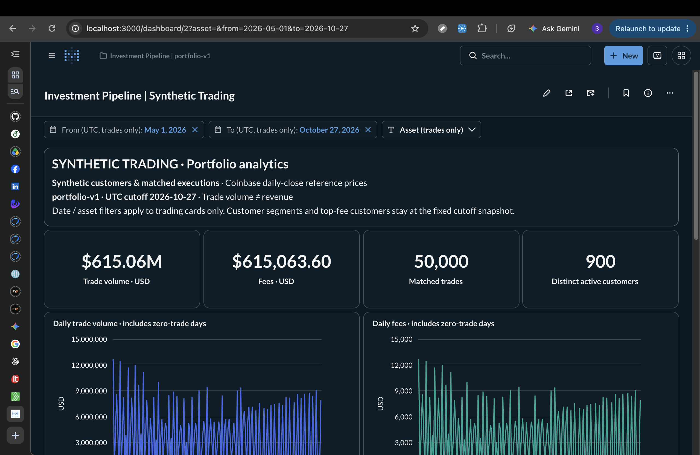
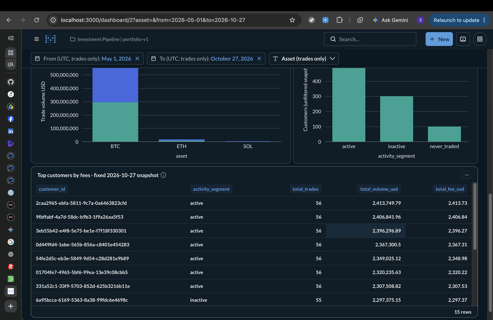

# Investment Data Pipeline & Analytics

A local batch pipeline that takes data from an API to an analytics dashboard, with
reconciliation across raw storage, normalized tables, facts, and marts.

Daily BTC, ETH, and SOL candles come from **Coinbase Exchange**. The customer and
execution data—**1,000 customers and 50,000 matched trades—are entirely synthetic**.
They provide a controlled dataset for testing aggregations, monetary calculations,
and customer activity summaries.

**Stack:** Python, PostgreSQL, dbt Core, Metabase, Docker Compose, and optional
Airflow orchestration. Daily price ingestion can run on a schedule; the fixed
analytics demo is built manually. GitHub Actions checks are verified on hosted
Ubuntu runners; see the CI verification link below. Raw API responses are also
copied to S3-compatible object storage with a Delta Lake manifest (see
[Delta Lake raw layer](#delta-lake-raw-layer)).
The project does not model balances, holdings, or P&L.

## Dashboard preview

Screenshots from local Metabase using `portfolio-v1`, with an **October 27, 2026 UTC**
cutoff. Customers and executions are synthetic; reference prices come from Coinbase.

**Trading overview:** volume, fees, trade count, distinct active customers, and daily trends.



**Breakdowns:** volume by asset and BUY/SELL, customer segments, and customers ranked
by fees. Customer cards remain fixed snapshots when trading filters change.



## Architecture and design choices

```text
Coinbase daily candles
  → raw.price_fetches: response bytes, SHA-256, request metadata
  → Python validation: UTC buckets, completeness, OHLC, Decimal
  → market.daily_prices: upsert by source/product/day
  → seeded generator: fixed daily-close inputs
  → synthetic.datasets → synthetic.customers → synthetic.trades

market/synthetic → dbt staging → dimensions/fact → daily/customer marts
  → read-only Metabase connection → SQL cards → dashboard

CSV fixture → separate PostgreSQL test server → the same dbt models
```

| Choice | Reason and trade-off |
| --- | --- |
| Store raw responses before normalization | Supports payload inspection and replay; raw rows grow with repeated requests. |
| Upsert prices by source/product/UTC day | Reruns preserve the grain and accept corrected prices; normalized tables retain only the latest version. |
| Fix the seed, date range, and price-input hash | Makes synthetic runs comparable; an existing dataset rejects changed inputs rather than regenerating silently. |
| Materialize staging as views and downstream models as tables | Straightforward reconciliation at demo scale; tables need rebuilding after source updates. |
| Run a small fixture through the same dbt models | Independent expected totals expose join, cutoff, and rounding errors that large totals can hide. |
| Use a separate SELECT role for Metabase | Dashboard queries read analytics; application metadata lives in a separate database and volume. |

Further detail: [design decisions](docs/decisions.md), [model contracts](docs/models.md),
and [verification evidence](docs/verification.md). These supporting documents are in Vietnamese.

## Local setup

Tested on macOS arm64 with Python 3.13.5 and Docker running Linux aarch64.
Python 3.11 or later is required. Check your environment first:

```bash
uname -m
python3 --version
docker --version
docker compose version
docker info --format '{{.OSType}} {{.Architecture}}'
git --version
```

Run commands from the repository root:

```bash
python3 -m venv .venv
.venv/bin/python -m pip install -r requirements-dev.txt
cp -n .env.example .env
chmod 600 .env
```

For a new `.env`, replace `POSTGRES_PASSWORD` with a random local password before
starting PostgreSQL. One way to generate it:

```bash
python3 -c 'import secrets; print(secrets.token_urlsafe(32))'
```

Keep the existing password when reusing an initialized database. Changing `.env`
does not change credentials already stored in a PostgreSQL volume. Never commit
`.env`. The selected public Coinbase endpoint does not require an API key.

```bash
.venv/bin/python scripts/init_metabase_env.py
.venv/bin/python scripts/init_lake_env.py
docker compose up -d --wait postgres
.venv/bin/python -m pipeline.init_db
```

PostgreSQL binds to `127.0.0.1:55432`, with a healthcheck and a dedicated volume.
Change `POSTGRES_PORT` if the port is occupied. The migration runner applies
`sql/NNN_*.sql` in order, records them in `public.schema_migrations`, and uses a
transaction and advisory lock. Rerunning it preserves existing data. Migration
`002` expands the supported products and renames `volume_btc` to `volume_base`.
Add new migrations instead of editing ones already applied.

## Collect market prices

The verified demo interval is **[2026-05-01, 2026-10-28) UTC**: 180 completed days.
Pass the dates explicitly so the run does not depend on values already in `.env`:

```bash
START_DATE=2026-05-01 END_DATE=2026-10-28 \
PRODUCTS=BTC-USD,ETH-USD,SOL-USD REQUEST_CHUNK_DAYS=60 \
.venv/bin/python -m pipeline.collector
```

Complete coverage produces 540 normalized rows. The collector checks every day;
product availability alone does not establish historical coverage. All three
products returned HTTP 200 and complete coverage in the verified interval.
Earlier history and access from other networks have not been established.

If both date settings are absent from the shell and `.env`, the collector uses
the latest 180 completed UTC days. Setting only one boundary is an error.
Shell environment variables take precedence over `.env`.

### API boundaries and failure handling

The [Coinbase candles endpoint](https://docs.cdp.coinbase.com/api-reference/exchange-api/rest-api/products/get-product-candles)
provides exchange-specific OHLCV, quoted in USD—not a market-wide average.

- Daily requests use `granularity=86400`. Timestamps are integer epoch seconds
  identifying the start of a UTC bucket.
- Responses can include the end boundary or candles before the start, in descending
  order. The client sorts and filters to `[start,end)`, rejecting duplicate days,
  missing days, unfinished days, and buckets outside UTC midnight.
- Requests use 60-day windows by default, capped at 299 days to allow for an
  inclusive-end candle within the provider's 300-candle limit. Total requested
  ranges can span 1–3,650 days; availability is still validated.
- Every product/window must pass validation before one normalized batch is
  committed. Raw attempts are committed separately. Missing candles cause failure;
  no interpolation or fixture substitution is used.
- Request pacing defaults to one second, with a minimum of 0.2 seconds. The
  [documented public limit](https://docs.cdp.coinbase.com/exchange/rest-api/rate-limits)
  is 10 requests/second/IP with a burst of 15. A live request exceeding 300 candles
  returned HTTP 400; throttling limits were not tested by flooding the API.
- Connect/read timeouts default to 5/20 seconds. The read timeout measures socket
  inactivity, not total run duration. Requests allow three attempts by default,
  capped at five. Timeouts, connection errors, and HTTP 408/429/500/502/503/504 are
  retried with bounded backoff and `Retry-After` handling. TLS certificate errors
  and permanent client errors are not retried. Delays above the wait budget abort
  the request.

### Storage contracts

| Table | Grain and key | Rerun behavior |
| --- | --- | --- |
| `raw.price_fetches` | One HTTP attempt; PK `fetch_id`, unique `(run_id,attempt_number)` | Append another attempt, preserving response history. |
| `market.daily_prices` | One `(source,product_id,price_date)` | Update OHLCV and lineage on conflict. |

`run_id` groups retries for **one request/window**, not an entire collector invocation.
Raw storage includes request parameters, UTC timestamps, HTTP status, decompressed
body bytes, SHA-256, transport errors, and allowlisted headers. Authorization and
cookies are excluded. Transport failures have NULL body/status. Raw rows survive
JSON or data-validation failures. If PostgreSQL is unavailable, collection stops;
there is no disk spool. Raw append-only behavior is an application convention,
not a separate database permission boundary.

Normalized `bucket_start` is midnight UTC for a completed day. Python `Decimal`
and PostgreSQL `NUMERIC` preserve precision; `volume_base` uses the product's base
asset. The last committed upsert wins, so collectors should run sequentially.
Idempotency compares keys and business values: `last_fetch_id` and `loaded_at` may
change. Normalized prices do not retain version history.

## Generate the synthetic dataset

First collect all 540 prices for the fixed interval, then run:

```bash
.venv/bin/python -m pipeline.synthetic \
  --dataset-id portfolio-v1 --seed 20261101 --start 2026-05-01 --end 2026-10-28
```

Generated data lives in the `synthetic` schema, separate from `raw` and `market`.
Rerun the same command to check reproducibility.

- **Customers:** 100 never trade, 600 follow a regular schedule, and 300 cease
  trading. Creation timestamps precede the start by 1–30 days. Customers are
  inserted before trades in the same transaction.
- **Trades:** 50,000 `MATCHED` BUY/SELL executions rotate across 900 customers,
  giving each 55 or 56 trades. Regular schedules span the full interval with gaps
  of at most four days; ceased schedules cover the first 120 days, leaving the
  final 60 days without trades. These are generator scenarios, not churn labels.
- **Identity:** UUID5 derives from generator version, dataset ID, and entity number.
  A fixed RNG seed controls timestamps, quantities, slippage, and customer creation.
- **Amounts:** quantity ranges from 0.001000 to 1.000000 base units. Execution price
  references that product's daily close with integer slippage from −25 to +25 bps.
  All monetary arithmetic uses `Decimal`:

```text
execution_price = round_half_up(reference_close × (1 + slippage_bps / 10000), 2)
notional_usd    = round_half_up(quantity × execution_price, 2)
fee_usd         = round_half_up(notional_usd × 0.001, 2)   # 10 bps, rounded per trade
```

**Assumption:** executions have intraday timestamps but reference the same day's
close. This introduces look-ahead if used for backtesting. These records are for
analytics testing, not real execution history or strategy evaluation. Funds,
inventory, and the ability to sell an asset are not simulated.

`synthetic.datasets` records the seed, interval, generator version, price-input
checksum, and business-content checksum. Inserts use `ON CONFLICT DO NOTHING`,
followed by full checksum comparison. Changed inputs under the same dataset ID
are rejected; use a new ID for a different dataset. A new fetch with unchanged
closing prices is allowed, while original trade lineage is preserved. Corrected
historical prices do not automatically reprice existing synthetic trades.

Foreign keys cover dataset/customer, market-price keys, and raw-fetch provenance.
Check constraints cover side, status, positive amounts, and monetary formulas.
Customer/trade ordering and schedule behavior are checked by the verifier.

## dbt analytics

Use a separate environment to preserve collector dependencies. dbt Core and
dbt-postgres 1.11.0 were installed and built successfully with Python 3.13.5:

```bash
python3 -m venv .venv-dbt
.venv-dbt/bin/python -m pip install -r requirements-dbt.txt
.venv-dbt/bin/dbt --version
.venv-dbt/bin/python -m pip check
```

Project and profiles live in `analytics/`; no external dbt packages are required.
The wrapper loads `.env`, preserves shell overrides, and passes the password via
`DBT_ENV_SECRET_PASSWORD`, not command-line arguments. `DBT_DATABASE` defaults to
`POSTGRES_DB`. Output schemas must be `analytics` or start with `analytics_`;
source schemas default to `synthetic` and `market`.

```bash
.venv/bin/python scripts/run_dbt.py build --vars '{"dataset_id":"portfolio-v1","as_of_date":"2026-10-27"}'
```

The cutoff includes October 27 UTC, ending before `2026-10-28T00:00:00Z`.
`dataset_id` and `as_of_date` have fixed defaults in `dbt_project.yml`, overridable
with `--vars`; reports do not depend on `CURRENT_DATE`. Customers and trades must
exist before the cutoff. Each output schema holds one dataset/cutoff snapshot.
Use another `DBT_SCHEMA=analytics_*` to retain a separate snapshot. Builds replace
derived output without modifying sources. The schema guard is not a substitute
for database permissions; dbt currently uses the local development account.

| Models | Materialization | Grain |
| --- | --- | --- |
| `stg_customers` | View | Dataset/customer within the cutoff |
| `stg_trades` | View | Dataset/trade within the cutoff |
| `stg_asset_prices` | View | Source/product/UTC price day |
| `dim_assets` | Table | Source/product |
| `dim_date` | Table | UTC calendar day |
| `fact_trades` | Table | Dataset/execution, enriched through complete join keys |
| `mart_daily_trading` | Table | Dataset/day with at least one trade, across all assets and sides |
| `mart_customer_summary` | Table | Dataset/customer, including customers without trades |

Trade volume is `SUM(notional_usd)`, **not revenue**. Fees sum amounts already
rounded per execution. Active-customer counts use `COUNT(DISTINCT customer_id)`
at the reporting grain and cannot be summed across days, assets, or sides.

Customer summary uses a LEFT JOIN: customers without trades have zero totals and
NULL first/last dates and recency. Segments come from trades through the cutoff,
not the generator's profile: `never_traded`, `active` (≤30 days), `at_risk`
(31–59 days), and `inactive` (≥60 days). These are demo rules, not RFM or churn inference.
See [model contracts](docs/models.md) for columns, keys, and lineage.

### Why 116 trading days across 180 price days?

The generator synchronizes schedules within cohorts. Regular customers use two
shared schedules of 55/56 trades, covering 91 distinct days. Ceased customers use
55 days within the first 120 days. The schedules overlap on 30 days:
`91 + 55 − 30 = 116` trading days, leaving 64 zero-trade days. This reflects the
synthetic generator, not customer behavior observed in a real market.

The daily mart keeps only trading days and has no asset/side dimension. Dashboard
queries use `dim_date` to display zero-trade days and read `fact_trades` for asset
and side breakdowns.

## Verification and reconciliation

Recorded runs passed **52 Python tests** and a demo dbt build with **8 models and
88 data tests**. Staging, fact, daily mart, and customer summary reconciled to:

| Metric | Verified demo result |
| --- | ---: |
| Trades | 50,000 |
| Trade volume | USD 615,063,969.51 |
| Fees | USD 615,063.60 |
| Distinct active customers across the interval | 900 |
| Customers retained in the summary | 1,000 |
| Segments: active / inactive / never traded | 600 / 300 / 100 |

These are synthetic trading totals. API collection, mock-based failure tests,
and fixture builds are documented separately in [verification](docs/verification.md).

```bash
.venv/bin/python -m pytest -q
.venv/bin/python -m pipeline.verify_stage2a --dataset-id portfolio-v1
docker compose exec -T postgres sh -c 'psql -v ON_ERROR_STOP=1 -U "$POSTGRES_USER" -d "$POSTGRES_DB"' < sql/verify_2a.sql
docker compose exec -T postgres sh -c 'psql -v ON_ERROR_STOP=1 -U "$POSTGRES_USER" -d "$POSTGRES_DB"' < sql/verify_2b.sql
```

Quick SQL checks:

```sql
SELECT product_id, count(*), min(price_date), max(price_date)
FROM market.daily_prices
WHERE price_date >= '2026-05-01' AND price_date < '2026-10-28'
GROUP BY product_id;

SELECT count(*), sum(notional_usd), sum(fee_usd) FROM analytics.fact_trades;
SELECT sum(trade_count), sum(trade_volume_usd), sum(fees_usd) FROM analytics.mart_daily_trading;
SELECT activity_segment, count(*) FROM analytics.mart_customer_summary GROUP BY 1;
-- Count customers across the whole interval directly from fact.
SELECT count(DISTINCT customer_id) FROM analytics.fact_trades;
```

To replay one stored HTTP 200 response in two committed transactions:

```bash
.venv/bin/python -m pipeline.verify_idempotency --fetch-id <UUID-response-200>
```

Choose the latest response for its product/window. Replay compares row counts and
OHLCV, upserts normalized prices, and adds no raw rows or API calls. Replaying an
older response can overwrite newer price corrections.

### Fixture builds and fresh migrations

The [reconciliation fixture](tests/fixtures/reconciliation/README.md) contains four
customers, six trades, and fabricated prices. Independent expected totals are
**USD 475.94 notional and USD 0.48 fees**, grouped by customer/product/side/date.
Rounding cases include `0.055 → 0.06` and `30.075 → 30.08`.

```bash
.venv/bin/python scripts/verify_dbt.py
```

The script starts `compose.test.yaml` under project `de_pj_2b_test`, on loopback
port 55433. PostgreSQL uses tmpfs and **does not mount the demo volume**. Set
`TEST_POSTGRES_PORT` if needed; the script rejects the demo port. Each run creates
`verify_2b_<UUID>`, applies migrations 001/002 twice, and loads CSV into
`fixture_input`. It does not write fixtures to demo `market`/`synthetic`, call the
price API, or regenerate the 50,000 trades.

The same eight models and 88 tests run at four cutoffs: 2026-05-03, 2026-05-01,
2026-06-02, and 2026-07-02. Output SQL queries check expected JSON totals,
row-level amounts, daily distinct counts `[1,1,2]`, zero-trade customers, future
rows, and recency boundaries. Distractor rows reuse UUIDs in another dataset or
product/day keys under another provider to expose incomplete joins.

Demo-source checksums are compared before and after. Test databases are retained
for inspection; tmpfs is temporary test storage, not a backup. Logs and artifacts
are ignored under `data/verify_2b_*/`. Unit tests use mocks/in-memory inputs;
fixture builds exercise actual dbt SQL. Neither substitutes for live API evidence.

Generate dbt documentation locally:

```bash
.venv/bin/python scripts/run_dbt.py docs generate
# Optional local documentation server:
.venv/bin/python scripts/run_dbt.py docs serve --port 8081
```

## Metabase setup

Run collection, synthetic generation, and dbt first. A clone contains code and
fixtures, not the local database or volumes.

```bash
.venv/bin/python scripts/init_metabase_env.py
.venv/bin/python scripts/setup_metabase_role.py
docker compose up -d --wait metabase
.venv/bin/python scripts/setup_metabase.py
.venv/bin/python scripts/verify_metabase.py
```

The setup script prints the dashboard URL and writes `data/metabase-state.json`.
On the development machine it is **http://localhost:3000/dashboard/2**; IDs can
change with a fresh metadata database.

Log in with `METABASE_ADMIN_EMAIL` (default `admin@investment.local`) and
`METABASE_ADMIN_PASSWORD` from `.env`. The environment initializer fills only
missing/placeholder values, preserves existing credentials, and sets `.env` to
mode 0600. The UI administrator is separate from the database query user.

The pinned application tag is `metabase/metabase:v0.64.1`, verified to run natively
on arm64. It binds to loopback port 3000, configurable with `METABASE_PORT`.
`metabase_db` is a separate PostgreSQL service with the `metabase_metadata` named
volume and no published host port. Application metadata does not use H2.

The business-database connection uses **`metabase_reader`**, through
`postgres:5432` on the Compose network. The role has analytics SELECT access and
no table write or schema CREATE privileges. Default privileges preserve SELECT
on new relations created by the same dbt owner. Role setup uses the local owner;
dashboard queries use only reader credentials.

Retain `.env`, `METABASE_ENCRYPTION_KEY`, and the metadata volume together so
Metabase can decrypt saved database credentials. Setup updates the named
collection, cards, and dashboard on rerun. Edit card SQL and rerun setup to update
the dashboard. Metabase's API is unversioned; provisioning was verified against
the running v0.64.1 container's OpenAPI specification.

### Cards and filter scope

Nine SQL cards are stored in `metabase/cards/`:

- Four KPIs: trade volume, fees, trade count, and distinct active customers.
- Two daily charts: volume and fees, padded to 180 days using `dim_date`.
- A stacked volume chart by asset and BUY/SELL, queried from fact.
- Customer segments and the top 15 customers by fees, fixed at the cutoff.

From/To are inclusive UTC dates, defaulting to May 1–October 27, 2026. Asset
options are BTC/ETH/SOL, with all selected by default. These filters map only to
the seven trading cards. Customer counts come directly from filtered fact.
Trades are filtered before the calendar LEFT JOIN so zero-trade days remain.
The dashboard range is bounded by the demo interval.

The two customer cards have no template tags or filter mappings. They retain the
1,000-customer snapshot even when June/ETH is selected. Changing the snapshot
cutoff requires a dbt build and an explicit dashboard-contract update.

### Dashboard verification

```bash
.venv/bin/python scripts/verify_metabase.py
docker compose exec -T postgres sh -c 'psql -v ON_ERROR_STOP=1 -U "$POSTGRES_USER" -d "$POSTGRES_DB"' < sql/verify_3.sql
# Restart the application without removing the metadata volume.
docker compose restart metabase
docker compose up -d --wait metabase
.venv/bin/python scripts/verify_metabase.py
```

The verifier queries saved cards through Metabase and compares results with
independent parameterized SQL using the reader role. It checks daily rows,
asset/side totals, customer rankings, segments, filter mappings, and ACL rejection
of UPDATE even with transaction read-only disabled. Dashboard/card IDs, SQL,
filters, and visualization settings were also compared before and after restart.

| Trading filters | Trades | Volume USD | Fees USD | Distinct customers |
| --- | ---: | ---: | ---: | ---: |
| Default interval | 50,000 | 615,063,969.51 | 615,063.60 | 900 |
| June 1–30 | 9,300 | 100,591,957.72 | 100,591.72 | 900 |
| ETH, full interval | 16,667 | 17,344,749.48 | 17,345.27 | 300 |
| June + ETH | 3,100 | 2,633,325.78 | 2,633.37 | 300 |

Additional screenshots from the in-app browser show
[default volume/fees](docs/screenshots/metabase-default-kpis.jpg),
[default trade/customer counts](docs/screenshots/metabase-default-counts.jpg), and
[June + ETH](docs/screenshots/metabase-june-eth.jpg).
They capture the visible narrow viewport, not a full desktop dashboard.
Date/asset controls were exercised in that browser; desktop Chrome/Safari layout
was not independently verified by the agent. SMTP, email password reset, and
public dashboard sharing are not configured.

## Delta Lake raw layer

PostgreSQL `raw.price_fetches` remains the system of record. This layer copies every
HTTP attempt to object storage, so raw inputs can be kept and replayed outside the
database that serves the dashboard. It is a data lake layer beside the warehouse,
not a lakehouse: metrics are still defined and computed only in dbt.

```text
raw.price_fetches (PostgreSQL)
  → bronze/coinbase/<sha256>               one object per distinct response body
  → manifest/coinbase_price_fetches        Delta table, one row per HTTP attempt
```

```bash
.venv/bin/python scripts/init_lake_env.py      # fills LAKE_* keys in .env once
docker compose up -d --wait lake_storage
.venv/bin/python -m pipeline.lake              # creates the bucket, copies, appends
.venv/bin/python scripts/verify_lake.py        # read-only reconciliation
```

| Choice | Reason and trade-off |
| --- | --- |
| RustFS 1.0.3 as S3-compatible storage | The MinIO repository is archived and its Docker Hub image is gone. RustFS is Apache-2.0 and actively released; it is younger than MinIO. |
| Content-addressed keys (`<sha256>`) | Identical responses are stored once; the key itself proves integrity. Upload uses `If-None-Match: *`, so an existing key is never overwritten. |
| Delta manifest, one row per attempt | Keeps failed attempts (no body, no object) and request metadata; time travel shows what had been exported at each version. |
| Insert-only MERGE on `fetch_id`, skip empty commits | A rerun adds no rows and no new Delta version. |
| Exact Arrow schema check before writes | Delta accepted a float into a DECIMAL column and rounded it silently, so its own schema check is not enough. |
| Python `deltalake` (delta-rs), no Spark | Hundreds of rows do not need a distributed engine or a JVM. |

Observed on 2026-11-09: 41 raw attempts, 25 distinct bodies → 25 objects (66,768
raw body bytes) and 41 manifest rows at Delta version 0. A rerun uploaded 0 objects,
inserted 0 rows and kept version 0; PostgreSQL raw rows were unchanged. Verification
caught an intentionally corrupted object and passed again after restoring its bytes
from PostgreSQL. Details: [verification](docs/verification.md).

Read Delta tables on S3 through `QueryBuilder` (SQL), not `to_pyarrow_table()`.
With deltalake 1.6.6 on RustFS the latter returned data but the process hung at exit.

## Repository guide

| Path | Purpose |
| --- | --- |
| `pipeline/config.py`, `pipeline/collector.py` | Date windows, HTTP retries, raw capture, and load coordination |
| `pipeline/normalize.py`, `pipeline/db.py` | UTC validation, Decimal parsing, and upserts |
| `pipeline/init_db.py`, `sql/00*.sql` | Additive, rerunnable migrations |
| `pipeline/synthetic.py` | Seeded generation, stable IDs, and dataset guards |
| `pipeline/verify_stage2a.py`, `pipeline/verify_idempotency.py` | Source checks and raw-response replay |
| `analytics/models/`, `analytics/tests/`, `analytics/macros/` | dbt transformations, data tests, and key/scope macros |
| `scripts/run_dbt.py`, `scripts/verify_dbt.py`, `compose.test.yaml` | dbt environment wrapper and isolated integration checks |
| `metabase/cards/`, `scripts/setup_metabase*.py` | Dashboard SQL, provisioning, and reader-role setup |
| `scripts/verify_metabase.py`, `sql/verify*.sql` | API-to-SQL checks and independent reconciliation queries |
| `pipeline/lake.py`, `scripts/verify_lake.py`, `scripts/init_lake_env.py` | Raw objects in S3-compatible storage, Delta manifest, and reconciliation |
| `tests/fixtures/reconciliation/` | Small fixture and independent expected totals |
| `compose.yaml`, `.env.example` | Services and environment configuration |
| `docs/` | Design decisions, model contracts, and verification records |
| `.github/workflows/ci.yml`, `scripts/verify_ci.py`, `compose.ci.yaml` | CI workflow and isolated local reproduction |
| `AGENTS.md` | Repository working rules |

## Operations and limitations

Use `docker compose ps` and `docker compose logs --tail=100 postgres` to inspect
failures. Stop with `docker compose stop`; resume with `docker compose up -d --wait`.
Do not delete volumes or data to resolve startup errors.

- PostgreSQL uses `postgres:16-bookworm`, without a pinned digest. Python direct
  dependencies are pinned; there is no transitive dependency lockfile.
- Airflow schedules price ingestion locally; GitHub Actions verifies code and
  fixture models. Alerting and a business run-status table are not implemented.
  Backfill/manual collection must remain sequential; external concurrent writes
  and production load have not been tested.
- Isolated fresh migrations and fixture builds were tested. A complete pipeline
  run from an empty clone, backup/restore, metadata-database restart, and failure
  recovery have not been verified.
- The Delta Lake layer is exported manually and covers raw price responses only.
  Silver prices, published report snapshots, CI against object storage, AWS S3
  and concurrent writers are not implemented or tested.
- dbt tables require rebuilding after source updates. Incremental models,
  historical snapshots, SCD2, retention, RFM scoring, and AI agents are outside
  the current implementation.

See [verification](docs/verification.md) for executed checks and remaining gaps.

## Airflow: daily market-price ingestion

Airflow 3.3.2 runs in an opt-in Compose overlay with LocalExecutor, a dedicated
metadata PostgreSQL service, and persistent auth/log volumes. The image uses
Python 3.12 and the matching upstream constraints; Airflow packages are not
installed in the collector or dbt virtual environments.

```bash
.venv/bin/python scripts/init_airflow_env.py
.venv/bin/python scripts/setup_airflow_role.py
docker compose -f compose.yaml -f compose.airflow.yaml build airflow_init
docker compose -f compose.yaml -f compose.airflow.yaml up -d --wait airflow_api airflow_scheduler airflow_dag_processor
```

Open **http://localhost:8081** (or `AIRFLOW_PORT`). Use `AIRFLOW_LOCAL_ADMIN_USER`
and `AIRFLOW_LOCAL_ADMIN_PASSWORD` from `.env`. The local SimpleAuthManager stores passwords in plaintext in its private auth
volume and reads pre-initialized credentials from a persistent file instead of generating passwords
in logs. It is a development authentication mechanism, not a production deployment.
Only the init service uses root to assign ownership to new auth/log volumes;
runtime services run as the image's `airflow` user. Keep `.env`, auth/metadata/log
volumes, the Fernet key, and JWT secret; rerunning initialization preserves them.
The optional dbt docs server must use a different port, for example 8082.

### Schedule and task contract

```text
market_prices_daily: collect_prices → verify_price_interval
```

The DAG starts paused. It uses an explicit daily UTC data-interval timetable,
with `catchup=False` and `max_active_runs=1`. A run covering `[D,D+1)` receives
both dates directly; `.env`'s historical dates cannot override them. Enabling the
DAG may immediately schedule the latest completed interval. A fixed start date
of 2026-10-28 limits the schedule's history; it is not a moving `today()` value.

All three products remain in one collection task and one normalized transaction.
The downstream check compares coverage, OHLCV, SHA-256, and fetch lineage against
the exact successful raw responses. XCom contains only dates, counts, products,
and fetch IDs; response bodies remain in PostgreSQL. Airflow tracks task/run
state in its metadata DB; this does not add a business run-status table.

The `airflow_collector` role can SELECT/INSERT raw attempts and SELECT/INSERT/UPDATE
normalized prices. It cannot write synthetic or analytics tables, delete price
history, create schemas, or run migrations. Tasks use `postgres:5432` inside the
Compose network and never receive owner or Metabase credentials.

Collection has three HTTP attempts per request and one additional task retry,
five minutes later. For a one-day, three-product run the upper bound is 18 HTTP
attempts. Task execution is limited to eight minutes and a DAG run to twenty.
Transient HTTP/database failures and missing candles may retry; configuration,
permanent HTTP/TLS, malformed payloads, and failed data checks fail immediately.
A failed collection blocks verification and makes the DAG fail. `Retry-After`
above the configured budget stops the task without an extra task retry.

### Manual runs, backfill, and reprocessing

```bash
.venv/bin/python scripts/airflow_local.py pause --unpause
# Explicit manual interval; end is exclusive and the range is limited to seven days.
.venv/bin/python scripts/airflow_local.py run --start 2026-10-28 --end 2026-10-29 --label manual
.venv/bin/python scripts/airflow_local.py status
# Fill missing scheduled runs for three completed UTC days.
.venv/bin/python scripts/airflow_local.py backfill --start 2026-10-29 --end 2026-11-01
# Reprocess already completed runs, accepting possible provider corrections.
.venv/bin/python scripts/airflow_local.py backfill --start 2026-10-29 --end 2026-11-01 --reprocess completed
# Inspect the backfill ID printed by the previous command (example: 2).
.venv/bin/python scripts/airflow_local.py backfill-status 2
# Leave the local project paused when not demonstrating the scheduler.
.venv/bin/python scripts/airflow_local.py pause
```

The CLI takes an exclusive end and translates it to Airflow's inclusive backfill
logical-date bounds. In the verified 3.3.2 run, completed reprocessing reused the
existing run ID and incremented task try numbers; inspect tasks/backfill status
rather than expecting a new run ID. The backfill-specific active-run limit is also one; the
`coinbase_serial` one-slot pool serializes tasks. Do not overlap backfill with
manual reprocessing or run the standalone collector at the same time. The pool
does not coordinate external Python processes or make concurrent source writes safe.

In the UI, open the run, inspect task attempts/logs, and use Clear to retry an
existing run after resolving its cause. Clearing collection adds raw attempts and
upserts existing keys. When reprocessing an older run whose price lineage has
since changed, clear both collection and verification. For a manual UI trigger,
provide JSON with ISO `start` and
`end`; an empty configuration fails rather than selecting an implicit date range.

```bash
docker compose -f compose.yaml -f compose.airflow.yaml logs --tail=100 airflow_scheduler airflow_dag_processor
docker compose -f compose.yaml -f compose.airflow.yaml restart airflow_api airflow_scheduler airflow_dag_processor
docker compose -f compose.yaml -f compose.airflow.yaml up -d --wait airflow_api airflow_scheduler airflow_dag_processor
docker compose exec -T postgres sh -c 'psql -v ON_ERROR_STOP=1 -U "$POSTGRES_USER" -d "$POSTGRES_DB"' < sql/verify_4a.sql
```

Logs are in the `airflow_logs` volume and accessible through the task UI. Stop
Airflow services explicitly rather than stopping the business database. Do not
use `down --volumes` or reset metadata to recover from a failed task.

`portfolio-v1`, synthetic trades, the dbt cutoff, and the customer dashboard remain
fixed. Scheduled ingestion can add newer market dates without regenerating the
demo. A real historical close correction may cause the synthetic input guard to
reject regeneration; do not bypass that guard or overwrite the fixed dataset.

### Isolated Airflow failure/retry checks

The verification image adds test-only DAGs; the normal image does not include them.
HTTP responses are mocked and prices are written only to a separate tmpfs server.

```bash
# Build the normal image first, then the verification image.
docker compose -f compose.yaml -f compose.airflow.yaml -f compose.airflow.test.yaml build airflow_api
docker compose -f compose.yaml -f compose.airflow.yaml -f compose.airflow.test.yaml up -d --wait airflow_fixture_db
# On a fresh fixture server only; preserve existing test data on subsequent checks.
docker compose -f compose.yaml -f compose.airflow.yaml -f compose.airflow.test.yaml exec -T airflow_fixture_db psql -v ON_ERROR_STOP=1 -U airflow_collector -d investment_4a_test < sql/001_schema.sql
docker compose -f compose.yaml -f compose.airflow.yaml -f compose.airflow.test.yaml exec -T airflow_fixture_db psql -v ON_ERROR_STOP=1 -U airflow_collector -d investment_4a_test < sql/002_multi_asset_synthetic.sql
docker compose -f compose.yaml -f compose.airflow.yaml -f compose.airflow.test.yaml up -d --wait airflow_api airflow_scheduler airflow_dag_processor
.venv/bin/python scripts/verify_airflow.py
# Return to the normal image after test runs finish; retain metadata and test data.
docker compose -f compose.yaml -f compose.airflow.yaml up -d --wait airflow_api airflow_scheduler airflow_dag_processor
```

Failure checks execute the production task functions: an incomplete second product
must leave no partial normalized batch and block verification. A separate run
exhausts three mocked HTTP 503 attempts, then succeeds on the second task attempt.
The test retry delay is two seconds; production uses five minutes. Test-run state
and artifacts are recorded separately from live collection evidence.

## Continuous integration

[The GitHub Actions workflow](.github/workflows/ci.yml) runs on pull requests,
pushes to `main`, and manual dispatch. It defines three checks:

| Check | Environment | What it verifies |
| --- | --- | --- |
| Python tests | Python 3.12 and 3.13 on Ubuntu 24.04 | Collector mocks, UTC boundaries, money/fixtures, orchestration adapters, CI isolation guards, and Delta manifest writes on a local path |
| dbt reconciliation | Python 3.12, PostgreSQL 16 service | Fresh migrations and rerun, four fixture cutoffs, independent totals, and output-schema protection |
| Airflow DAG contract | Pinned Airflow 3.3.2 image | Production DAG imports and task/schedule limits, with container networking disabled |

No live price requests, synthetic demo regeneration, Metabase provisioning, or
Airflow scheduler startup takes place in CI. DAG parsing does not replace the
runtime retry/persistence checks recorded for local Airflow.

The PostgreSQL service uses a public **test-only** password and CI-only user/database;
no GitHub repository secrets or credentials from `.env` are needed. The runner
creates a fresh `ci_verify_<UUID>` database, reuses the existing fixture loader and
reconciliation assertions, and builds the same eight dbt models with 88 tests at
each cutoff. Baseline totals remain USD 475.94 notional and USD 0.48 fees.
Attempting to compile with `DBT_SCHEMA=market` must be rejected by the schema guard.

The CI entry point, `scripts/verify_ci.py`, requires explicit `CI_POSTGRES_*`
settings. It does not load `.env`, start the local demo stack, or connect to its
databases. It rejects demo database/user/host settings and ports 55432/55433.
Collector and dbt dependencies stay in separate virtual environments.

Actions are pinned to full commit SHAs. The workflow grants only `contents: read`,
disables checkout credential persistence, limits job timeouts, and cancels
superseded runs. Reports are uploaded even when a check fails: JUnit XML, fixture
reports, per-case dbt run results/manifests, and diagnostic logs. Artifact paths
are explicitly listed rather than uploading the workspace. Hosted artifacts have
a seven-day lifetime; this is CI diagnostic storage, not source-data retention.

### Reproduce the database checks locally

This standalone Compose project runs Linux Python 3.12 and a separate PostgreSQL
server. It does not mount the repository, `.env`, or demo volumes. Its Docker build
context excludes local credentials and generated dbt artifacts.

```bash
docker compose -p de_pj_ci -f compose.ci.yaml build ci_runner
docker compose -p de_pj_ci -f compose.ci.yaml up -d --wait ci_postgres
docker compose -p de_pj_ci -f compose.ci.yaml run ci_runner
```

The database binds loopback port 55434 and uses tmpfs. Test databases and the
`ci_artifacts` named volume remain available for inspection. A rerun creates a new
CI database; do not delete demo data or reset volumes to repeat the check.

To parse the Airflow DAG independently:

```bash
docker build -f orchestration/Dockerfile -t investment-airflow-ci .
docker run --rm --network none -e AIRFLOW__CORE__LOAD_EXAMPLES=false -i --entrypoint python investment-airflow-ci < orchestration/check_dag.py
```

Local verification passed 52 Python tests on macOS Python 3.13 and in Linux Python
3.12, all four fixture builds (96 successful nodes each), the schema guard, and
offline DAG parsing. `actionlint` also passed. The [first GitHub-hosted run](https://github.com/sanh0804/investment-data-pipeline/actions/runs/42075415267)
passed all four jobs on Ubuntu 24.04 for commit `2249420`. Downloaded artifacts
confirmed 52 tests on each Python version and 96 successful dbt nodes at each
fixture cutoff, including the independent totals and schema guard. Branch
protection and required status checks have not been configured.
