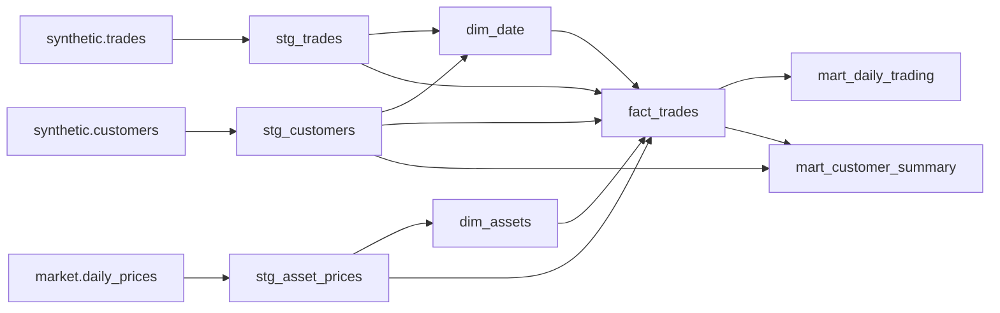

# Analytics contract — chặng 2B

Project dbt: `analytics/`. Sources đọc existing synthetic/market, dbt chỉ ghi vào
`analytics` hoặc schema bắt đầu bằng `analytics_`. Demo dùng PostgreSQL hiện có;
fixture/migration tests dùng server tmpfs riêng, port 55433. Không ghi fixture vào
market/synthetic demo. Credentials chỉ ở env, password dùng DBT_ENV_SECRET_PASSWORD.

## Cấu hình và thời gian

- `dataset_id`: mặc định `portfolio-v1`, scope của toàn bộ customers/trades.
- `as_of_date`: mặc định **2026-10-27**, inclusive UTC; cutoff exclusive là
  2026-10-28T00:00:00Z. Không dựa vào ngày hệ thống hoặc CURRENT_DATE.
- `price_source`: mặc định `coinbase_exchange`. Source khác không được join lẫn.
- `customer_source_schema=synthetic`, `price_source_schema=market`; fixture tests
  đổi cả hai sang `fixture_input` trong DB kiểm thử và price_source=`fixture`.
- Khách được tính nếu created_at trước cutoff exclusive; trade được tính nếu
  traded_at trước cutoff exclusive. Không thêm lower bound làm mất lịch sử customer.
- Customer totals là toàn bộ lịch sử **của selected dataset** tới ngày chốt,
  không khẳng định là lifetime ngoài khoảng dữ liệu dataset.
- Build là một snapshot logic theo vars trong một schema; build lại thay derived
  relations ở schema đó, không giữ nhiều as_of_date hoặc dataset trong cùng bảng.
  Muốn so hai snapshot đồng thời dùng hai DBT_SCHEMA analytics_* khác nhau.

## Grain, key và materialization

| Model | Grain / natural unique key | Surrogate key | Materialization |
| --- | --- | --- | --- |
| stg_customers | dataset_id, customer_id, đủ điều kiện ngày chốt | customer_key | view |
| stg_trades | dataset_id, trade_id, trước cutoff | trade_key | view |
| stg_asset_prices | source, product_id, price_date, <= as_of_date | price_key | view |
| dim_assets | source, product_id | asset_key | table |
| dim_date | date_day UTC | date_day | table |
| fact_trades | dataset_id, trade_id sau enrichment, vẫn một dòng/execution | trade_key | table |
| mart_daily_trading | dataset_id, trade_date có ít nhất một trade | composite natural key | table |
| mart_customer_summary | dataset_id, customer_id, gồm zero-trade customers | customer_key | table |

Surrogate keys là MD5 của JSONB array các thành phần natural key, không ghép chuỗi
bằng delimiter mơ hồ. Keys phục vụ analytics, không dùng cho bảo mật. SQL joins
dùng full natural keys; không dựa vào giả định UUID globally unique của fixture.
`unique_key`, unique/not_null tests kiểm tra cả natural và surrogate keys.

## Lineage và joins

Fact dùng LEFT JOIN để row thiếu dimension không tự biến mất:

- Customer: `(dataset_id,customer_id)`.
- Asset: `(source,product_id)`.
- Price: `(source,product_id,price_date)`, không join chỉ theo asset hoặc chỉ ngày.
- Date: `trade_date=date_day`.

Relationships và not_null enrichment columns làm build fail khi thiếu dimension;
unique tests và row-level/totals reconciliation phát hiện join fan-out. Không dùng
DISTINCT ở fact để che duplicate. DISTINCT ở dim_assets đúng với grain asset,
trong khi uniqueness giá theo ngày vẫn được test riêng.

## Columns

Descriptions từng cột được lưu trong `analytics/models/schema.yml` và dbt catalog.

**stg_customers:** dataset_id, customer_id/customer_key, customer_number, created_at,
created_date UTC. Không SELECT synthetic.activity_profile; label đó không đi vào segment.

**stg_trades:** dataset_id; trade_id/trade_key; customer_id/customer_key; source,
product_id, asset_key, price_key; traded_at, trade_date UTC, price_date; side,
status; quantity, reference_close, slippage_bps, execution_price, notional_usd,
fee_usd. Dùng money đã round ở nguồn, không tạo lại giá hoặc tính lại phí khi aggregate.

**stg_asset_prices:** source, product_id, price_date, price_key, asset_key, close_price.
Demo là API live Coinbase; source test là giá giả. Price snapshot trên trade vẫn
được giữ độc lập nếu provider chỉnh sửa lịch sử sau ngày sinh synthetic.

**dim_assets:** asset_key, source, product_id, base_asset, quote_currency (USD).
Không thêm tỷ giá hoặc gom quantity của các base assets khác nhau.

**dim_date:** date_day, year_number, quarter_number, month_number, day_of_month,
iso_day_of_week (Monday=1), is_weekend, month_start. Calendar bắt đầu từ min ngày
created/trade đã chọn tới as_of_date; không cần source price mỗi ngày customer tồn tại.

**fact_trades:** giữ **toàn bộ columns của stg_trades**, bổ sung customer_created_at,
base_asset, quote_currency, calendar_date và market_close_price (join evidence/context).
`reference_close` là giá snapshot dùng sinh execution; `market_close_price` là giá
market hiện có ở thời điểm dbt build. Không thay giá execution bằng market close.

**mart_daily_trading:** dataset_id, trade_date, as_of_date, trade_count,
active_customers, trade_volume_usd, fees_usd. Bao gồm mọi asset/side trong ngày;
không có row cho ngày zero-trade. Demo có 116 ngày có trade trong 180 ngày giá.
Đã xác minh DB: 116 rows = 116 distinct (dataset_id,trade_date); không có asset
hoặc side trong grain/schema của mart. Unique test dùng chính hai cột này.
Breakdown asset/side phải đọc fact, không đổi grain của mart ngầm.

116 ngày là hệ quả generator, không phải thiếu giá: 600 regular customers dùng
hai lịch cố định (500 khách có 56 trades, 100 khách có 55), tạo union 91 ngày;
300 ceased customers dùng một lịch 55 ngày trong 120 ngày đầu, overlap 30 ngày
với regular. Union = 91+55-30=116, còn 64 zero-trade days. Regular spacing nghĩa
khoảng cách giữa hai ngày trade của từng khách là 3 hoặc 4 ngày, không phải mỗi
ngày đều trade hay mỗi khách có lịch độc lập. Ceased spacing là 2 hoặc 3 ngày,
trade cuối 2026-08-28. Không sửa dữ liệu để tăng số ngày có giao dịch.

**mart_customer_summary:** dataset_id, customer_id/customer_key, created_at,
as_of_date, first_trade_date, last_trade_date, days_since_last_trade,
total_trades, total_volume_usd, total_fee_usd, activity_segment.
Customer LEFT JOIN một aggregate duy nhất theo dataset/customer.

## Metrics và behavior segments

| Metric | Định nghĩa | Giới hạn cộng dồn |
| --- | --- | --- |
| Trade volume USD | SUM(notional_usd) | Có thể cộng theo nhóm không chồng lấn; không gọi là revenue |
| Fees USD | SUM(fee_usd) đã round mỗi execution | Không round lại từ total volume × rate |
| Trade count | COUNT(*) của executions | Một trade đúng một dòng fact |
| Daily active customers | COUNT(DISTINCT customer_id) tại dataset/ngày | Không cộng distinct theo asset/side hoặc qua các ngày |
| Customer recency | as_of_date - last_trade_date UTC | NULL nếu chưa trade, không thay NULL bằng 0 |

Khách zero-trade: totals = 0; first/last dates và recency = NULL.
Demo rules tính từ lịch sử tới cutoff, không copy profile:

- `never_traded`: không có trade trước cutoff.
- `active`: days_since_last_trade <=30.
- `at_risk`: 31..59 ngày.
- `inactive`: >=60 ngày.

Đây chỉ là heuristic demo, không phải churn inference hoặc RFM scoring. Customer
profile `ceased` của fixture vẫn thành `active` tại 2026-05-03 vì mới trade một ngày trước.

## Verification contract

88 dbt data tests: uniqueness/nullability, relationships, accepted values,
source cutoff/count, source-money checks, row-level fact preservation, four-layer
count/volume/fee reconciliation, daily distinct và customer summary đối chiếu staging.

`scripts/verify_dbt.py` chạy cùng 8 models/88 tests trên fixture 4 customers/6 trades
với CSV + expected_totals.json. Thêm distractor dataset dùng cùng UUID, provider khác
cùng pair/day và future customer/trade để phát hiện sai join/scope/cutoff. Expected
totals baseline vẫn 475.94 USD/0.48 USD; daily distinct độc lập là [1,1,2].
Bốn cutoffs kiểm tra never-traded, loại future data, recency 0/30/31/60 và segments.
Script tạo test DB mới, chạy migrations hai lần và so checksum toàn bộ demo source
tables trước/sau. Artifacts test được giữ ở ignored data/; không phải bằng chứng API live.

Kết quả thực tế và phần chưa chạy: `docs/verification.md`.
